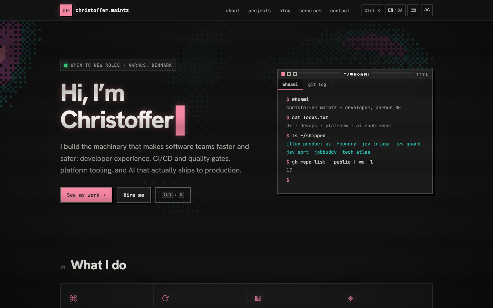

# cmaintz-site

Source for [maintz.dev](https://maintz.dev), my freelance site: services, projects, blog and CV in English and Danish. Astro, deployed as a Cloudflare Worker.



Beyond the pages, the site serves machine-readable versions of itself: Markdown for any page sent `Accept: text/markdown`, `/llms.txt`, an OpenAPI spec and a read-only MCP server at `/mcp`. Blog posts are written in Keystatic at `/keystatic` and can be cross-posted to dev.to.

## Commands

```sh
npm install
npm run dev        # http://localhost:4321
npm run editor     # Keystatic against files on disk: http://localhost:4321/keystatic
npm run build      # site + Pagefind search index -> dist/
npm run preview    # Workers runtime locally
npm run check      # types, code-size limits, comments SQL tests
npm test           # unit tests (Vitest)
npm run smoke      # interaction tests against the build (Playwright)
```

`mise run gate` runs the same checks as the CI gate. Deploys, secrets and content workflows are in [SETUP.md](SETUP.md); the rules for blog MDX are in [docs/blog-posts.md](docs/blog-posts.md).

## Layout

| Path           | What                                                        |
| -------------- | ----------------------------------------------------------- |
| `src/content/` | Projects and blog posts (schema in `src/content.config.ts`) |
| `src/data/`    | CV, services, packages and other hand-kept data             |
| `src/i18n/`    | English and Danish UI strings                               |
| `src/views/`   | Page bodies shared by `/x` and `/da/x`                      |
| `src/lib/`     | Logic: SEO, MCP, cross-posting, contact form                |
| `scripts/`     | GitHub sync, CV PDF, OG images, smoke tests                 |

## License

MIT, see [LICENSE](LICENSE).
