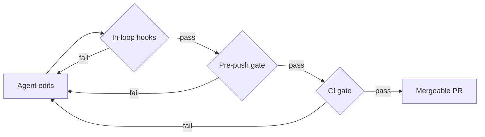

En CI-pipeline og et sæt "AI-kodestandarder" bliver som regel bygget som to separate ting - og så begynder de langsomt at være uenige. Pipelinen tjekker én ting, agentens instruktioner siger noget andet, og din pre-push hook er en tredje mening, som ingen kan huske at have skrevet.

[Foundry](/da/projects/foundry) tager udgangspunkt i noget andet: **det er ét regelsæt med tre placeringer.**

| Placering | Hvornår den kører | Feedback går til | Pris |
| --- | --- | --- | --- |
| In-loop | mens AI-agenten redigerer | agenten, midt i opgaven | gratis |
| Pre-push | før koden forlader maskinen | mennesket | gratis |
| CI | på hver pull request | den permanente historik | free tier |

Kører du *forskellige* regler hvert sted, får du klassikeren "virker lokalt, fejler i CI". Med agenter får du også noget, der er værre: agenten retter det, hooken markerede, CI brokker sig over noget andet, agenten retter det og ødelægger det første igen. Ét regelsæt, tre placeringer - ingen afvigelser, intet ping-pong.

## Det deterministiske er orakel

Den første bærende idé: **kun deterministiske værktøjer afgør bestået/fejlet.** Formatters, linters, type checkers, tests med minimumskrav til coverage og sikkerhedsscannere. En LLM må gerne *foreslå* en patch; patchen bliver kun accepteret, hvis gaten derefter består fra et rent tree.

<Callout type="note" title="Exit-koden er beviset">
"Modellen siger, den har rettet det" er ikke et bevis. Exit-koden er.
</Callout>

Det betyder også, at AI'en skal deles op i roller, som folk tit blander sammen: en **Fixer**, der laver afgrænsede patches, en **Reviewer**, der kun rådgiver og aldrig blokerer, og en **Triager**, der skiller ustabile fejl fra rigtige.



## Verber, ikke værktøjer

Hvert repo, uanset sprog, udstiller de samme seks verber gennem [mise](https://mise.jdx.dev), som også låser toolchainen fast:

```sh title="the whole interface"
mise run fix        # auto-fix what is mechanically fixable
mise run lint       # style + structural smells
mise run typecheck  # static types
mise run test       # tests + coverage floor
mise run audit      # vulnerabilities, secrets, SAST
mise run gate       # all of the above, in order - the oracle
```

CI, git hooks og agent-skills kalder alle **verber, aldrig værktøjer**. En skill siger `mise run lint`, aldrig `eslint` eller `phpstan`. Det ene lag af indirektion er grunden til, at ét skill-bibliotek kan betjene både et React-repo og et Kotlin-repo: ordforrådet for smells - `oversized-function`, `high-complexity`, `deep-nesting` - betyder det samme overalt; det er kun detektoren bag verbet, der skifter.

## Ratchet i stedet for gate

Sæt strikse linters på en rigtig kodebase, og alt er rødt på dag ét. I uge to har du opgivet det. Så i stedet bliver de eksisterende overtrædelser til en **baseline, der kun må skrumpe**. Ret en overtrædelse, og den er fjernet for altid; tilføj en ny, og gaten fejler.

Hvis <InlineMath expr="n_t" /> er antallet af overtrædelser i baselinen ved commit <InlineMath expr="t" />, er den eneste invariant, gaten håndhæver:

<Math expr="n_{t+1} \le n_t" />

Den billigste måde at gøre en linter tilfreds på er at svække reglen, så en lille `ruleset-guard` afviser enhver PR, der rører både et regelsæt *og* produktionskode, medmindre et menneske markerer den som bevidst. Den kender forskel på retning: en lempelse kræver et menneske, en stramning glider lige igennem.

## Hvad jeg ville sige til et team, der tager det her i brug

1. Vælg verberne først. Værktøjer kommer og går; det er interfacet, dine hooks, CI og agenter afhænger af.
2. Læg alt i baseline på dag ét, og lad så ratchet'en gøre arbejdet.
3. Hold AI'en ude af beslutningen om bestået/fejlet. Lad den foreslå; lad exit-koden bestemme.

Koden ligger på GitHub: [CMaintz/foundry](https://github.com/CMaintz/foundry) og [CMaintz/cmaintz-skills](https://github.com/CMaintz/cmaintz-skills).
