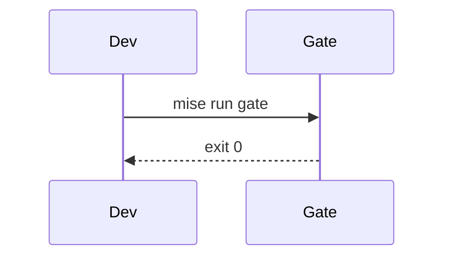

Det her er det første indlæg på min nye side, og den skal være et hjem for lidt af hvert. Noter om udviklerværktøjer, CI og kvalitets-gates, platformarbejde og at bygge med AI, selvfølgelig. Men også mine tanker, et brokkeri en gang imellem og de udvidede versioner af det, jeg skriver på LinkedIn og andre steder, når et par afsnit bare ikke er nok.

## Hvorfor den ser sådan ud

Jeg har altid elsket den retro-futuristiske teknologi i Alien, Blade Runner og lignende. Scanlines, gløden fra en CRT-skærm, klodsede terminaler med en blinkende markør, skærme der ser ud til at være bygget til at blive brugt frem for beundret. Så det er det, siden er bygget op omkring: gammeldags vinduer og et pixeleret felt, der summer i baggrunden, med helt moderne teknik nedenunder. (Bag længere tekst som den her træder scanlines høfligt til side, så den stadig er til at læse.)

## Under motorhjelmen

Siden er bygget med [Astro](https://astro.build) og kører på Cloudflares edge. Projektsiderne henter deres data direkte fra mine GitHub-repos, når siden bygges: sprog, stjerner, emner og selve README-filerne, så intet når at blive forældet. Alt findes på engelsk og dansk, og det hele bliver tjekket af den samme slags deterministiske kvalitets-gate, som jeg ville sætte på ethvert teams kode.

Jeg ville have ordentligt værktøj til teknisk skrivning, så indlæg her understøtter kode med titler, fremhævede linjer og diffs:

```ts title="src/lib/content.ts" {3}
export function repo(name: string) {
  const r = snapshot.repos.find((x) => x.name === name);
  if (!r) throw new Error(`Unknown repo: ${name}`);
  return r;
}
```

```diff lang="yaml"
- uses: actions/checkout@v4
+ uses: actions/checkout@8e5e7e5ab8b370d6c329ec480221332ada57f0ab # v5
```

Matematik, inline som <InlineMath expr="O(n \log n)" /> eller som blok:

<Math expr="\text{cost} = \sum_{i=1}^{n} p_i \cdot c_i" />

Diagrammer skrevet som almindelig tekst:



<Callout type="tip" title="Og callouts">
  Til de ting, der fortjener at skille sig ud.
</Callout>

## Ting, der er værd at pille ved

Et par detaljer, jeg havde alt for sjovt med at bygge:

- **En kommandopalet.** Tryk <kbd>Ctrl</kbd> + <kbd>K</kbd> (<kbd>⌘</kbd> + <kbd>K</kbd> på en Mac) hvor som helst. Fuzzy-søgning på tværs af alle sider, projekter og indlæg, piletasterne til at vælge, <kbd>Tab</kbd> til at fuldføre.
- **En terminal, der faktisk er en (lille) shell.** Den på forsiden skriver sig selv ud, men den sidste prompt tager imod input. Prøv `help`.
- **Kommentarer med samvittighed.** Log ind med GitHub eller Google, og kun dine initialer bliver nogensinde gemt eller vist. Dit navn forlader aldrig login-trinnet.
- **En hemmelighed eller to.** Nogle af dem er ældre end selve nettet.

Mere snart.
